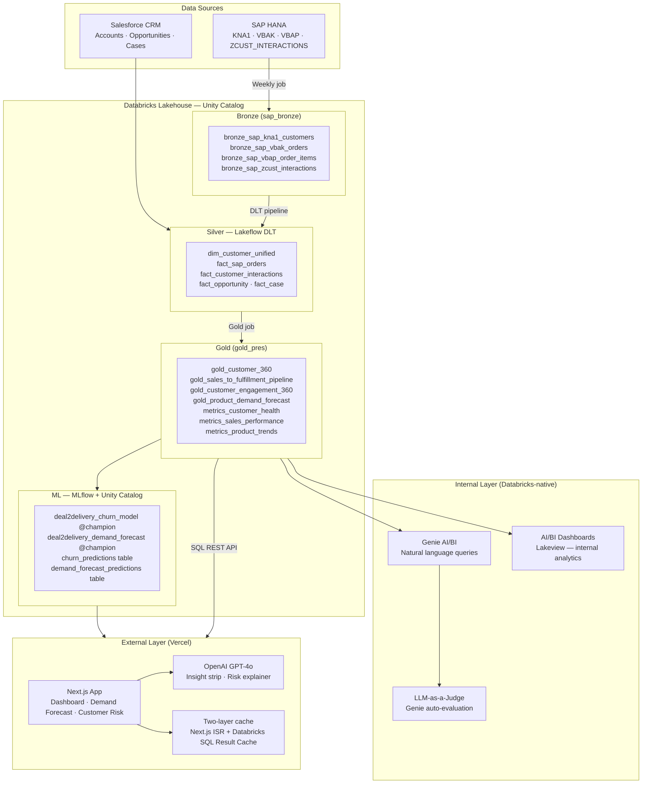
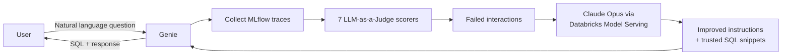

# Deal2Delivery — Unified SAP + Salesforce Demand Intelligence

> **Databricks DAIS 2026 Community Virtual Hackathon 2nd Place Winner**

---

> *"A deal closes in Salesforce on Friday. Delivery stalls in SAP on Monday. The customer churns by next quarter — and nobody saw it coming."*

**Deal2Delivery was built to close that gap. Permanently.**

---

## Meet NovaTech Solutions

NovaTech Electronics is a fast-growing B2B electronics retailer serving **70 enterprise clients** across technology, financial services, and professional services. They sell three product lines — computing devices (COMP: laptops, desktops, workstations), mobile devices (MOBI: smartphones, tablets, wearables), and accessories (ACCS: peripherals, hubs, docks) — with **$9.2M in annual revenue** tracked across 24 months of order history.

Their account teams live in **Salesforce**. Fulfillment, billing, and inventory run in **SAP HANA**. The two systems have never talked to each other — and that silence is costing them customers, stock, and deals.

**The symptoms are familiar:**
- A sales rep closes a $200K cloud deal. The ops team in SAP has no demand signal — inventory gaps are discovered only when fulfilment fails.
- A high-value customer goes quiet for 90 days. Nobody in Salesforce knows their support cases in SAP have been escalating for weeks. They churn silently.
- Demand planning is built on intuition, not data. SKU-level trends sit buried in SAP tables that only one engineer knows how to query.
- When the XGBoost model flags a customer as High Risk, the sales manager asks: *"Why?"* — and nobody can explain the model's reasoning.

Deal2Delivery unifies both systems on a **Databricks Lakehouse**, layers ML for churn prediction and demand forecasting, and surfaces the insights where each audience actually works — a **Genie AI/BI space** for internal data teams and a **public-facing Next.js app on Vercel** for business stakeholders.

---

---

## Table of Contents

- [Problem Statement](#problem-statement)
- [Solution Overview](#solution-overview)
- [Architecture](#architecture)
- [Consumption Layers — Why Both?](#consumption-layers--why-both)
- [Lakehouse Pipeline](#lakehouse-pipeline)
  - [Bronze — Raw Ingestion](#bronze--raw-ingestion)
  - [Silver — Lakeflow DLT](#silver--lakeflow-dlt)
  - [Gold — Business Views](#gold--business-views)
- [ML Models](#ml-models)
  - [Churn Prediction (XGBoost v2)](#churn-prediction-xgboost-v2)
  - [Demand Forecast (XGBoost)](#demand-forecast-xgboost)
- [Genie AI/BI — Natural Language Analytics](#genie-aibi--natural-language-analytics)
- [Next.js App — Vercel](#nextjs-app--vercel)
- [CI/CD Pipeline](#cicd-pipeline)
- [Project Structure](#project-structure)
- [Setup & Deployment](#setup--deployment)
- [Monitoring & Observability](#monitoring--observability)
- [Tech Stack](#tech-stack)

---

## Tech Stack

| Layer | Technology |
|-------|-----------|
| Data platform | Databricks (Serverless) |
| Storage | Delta Lake + Unity Catalog |
| Orchestration | Databricks Asset Bundles (DABs) |
| Ingestion | Python (SAP HANA → Bronze) |
| Transformation | Lakeflow Spark Declarative Pipelines |
| ML training | XGBoost + scikit-learn (K-Means) + Optuna |
| ML tracking | MLflow (experiments, runs, model registry) |
| Feature engineering | Composite behavioral scoring, RFM segments, lag features, StandardScaler |
| Model registry | Unity Catalog (`@champion` alias pattern) |
| AI/BI (internal) | Databricks Genie + AI/BI Dashboards |
| LLM evaluation | Claude Opus via Databricks Model Serving |
| Frontend | Next.js 14 (App Router) + Tailwind CSS + Recharts |
| AI (external) | OpenAI GPT-4o (insight strip + risk explainer) |
| Caching | Next.js ISR + Databricks SQL Result Cache |
| Hosting | Vercel |
| CI/CD | GitHub Actions + Databricks Asset Bundles |
| Language | Python (Databricks) · TypeScript (Next.js) |

---

## Problem Statement

NovaTech — like most enterprises — runs CRM and ERP in complete isolation:

| System | Knows | Blind to |
|--------|-------|----------|
| Salesforce | Customer demand signals, pipeline, sentiment | Inventory, fulfilment, procurement |
| SAP | Order execution, inventory, procurement | Customer intent, lifetime value, churn risk |

This disconnect causes stock shortages, over-procurement, delayed fulfilment, revenue leakage, and reactive planning — all because the signals that matter are split across systems that never talk to each other.

---

## Solution Overview

Deal2Delivery bridges both systems on a **Databricks Lakehouse**:

- Ingests SAP HANA + Salesforce CRM data into a unified Delta Lake
- Applies data quality rules via a **Lakeflow Spark Declarative Pipeline**
- Builds Gold-layer business views ready for analytics and AI
- Trains an **XGBoost churn model** (v2 — composite behavioral label + Optuna tuning) tracked in **MLflow** and registered in **Unity Catalog**
- Trains an **XGBoost demand forecast model** generating 6-month SKU-level predictions saved to a gold table
- Exposes a **Databricks Genie AI/BI** space for natural-language queries, auto-evaluated with **LLM-as-a-Judge** scorers
- Serves a **public-facing Next.js app on Vercel** with live Databricks SQL queries, ML predictions, and **OpenAI GPT-4o** AI explanations
- Manages all Databricks resources with **Databricks Asset Bundles (DABs)** across dev / staging / prod via **GitHub Actions CI/CD**

---

## Business Problems We Solve

| # | Business Problem | Why It Hurts | Databricks Solution | Key Features |
|---|---|---|---|---|
| 01 | **Siloed CRM & ERP** | Sales sees Salesforce; ops sees SAP — neither sees the full picture, causing stock shortages and unfulfilled wins | Databricks Lakehouse ingests and joins both into a single Delta Lake with governed access | Delta Lake · Unity Catalog · Lakeflow DLT |
| 02 | **Reactive Churn Management** | Sales reps discover churn only after customers go silent — no early warning from support cases, sentiment, or order behaviour | XGBoost churn model with composite behavioral label (inactivity + cases + sentiment + revenue decline), Optuna-tuned | MLflow · XGBoost · Optuna · Unity Catalog |
| 03 | **Gut-feel Demand Planning** | Demand plans built on intuition; SKU-level trends and seasonality buried in SAP tables nobody queries | XGBoost demand forecast trained on 24 months of SAP data with lag features — 6-month forward predictions in a gold table | MLflow · XGBoost · Delta Tables |
| 04 | **AI Inference Is a Black Box** | When a model flags a customer as high-risk, nobody can explain why — trust in AI is low | MLflow Tracing logs every customer scoring as a trace with nested spans: model prediction → LLM explanation chain | MLflow Tracing · Foundation Models · SpanType |
| 05 | **Insights Locked in Databricks** | Business stakeholders have no Databricks access — insights stay in internal dashboards only data engineers open | Next.js app on Vercel queries Databricks SQL REST API server-side. Public URL, no Databricks login, GPT-4o explanations | SQL REST API · SQL Result Cache · Next.js ISR |
| 06 | **Non-Technical Users Can't Query** | Questions like "Which customers haven't ordered in 60 days?" need a data analyst, a Jira ticket, and a week's wait | Genie AI/BI space backed by 8 gold views — type natural language, get SQL-powered answers instantly | Genie AI/BI · LLM-as-a-Judge · Claude Opus |
| 07 | **Every Query Hits the Warehouse** | Without caching, every page load sends a new query — seconds of latency and wasted DBUs on identical repeated queries | Two-layer cache: Next.js ISR (5-min Vercel CDN) + Databricks SQL Result Cache (24h) — zero extra DBUs after first run | SQL Result Cache · Delta Cache · Next.js ISR |
| 08 | **No Model Governance or Lineage** | Ad-hoc notebooks deploy models without version control — nobody knows which version is live or how accuracy changed | Every run tracked in MLflow. Models registered in Unity Catalog with `@champion` alias — production always uses the best version | MLflow Experiments · UC Registry · @champion |
| 09 | **No Inventory Visibility Against Forecast** | Demand is forecasted in isolation — nobody can see which SKUs are understocked against the 6-month predicted demand until it's too late | SAP MARD stock table ingested to bronze Delta, joined with ML forecast predictions in a gold view. Critical/Warning/OK classification surfaced in the app | Delta Lake · Gold Views · SAP MARD |
| 10 | **No Scenario Planning for Sales Teams** | Sales managers can't model "what if we run a 20% promo on Cloud products?" — demand planning is static, not interactive | Scenario Simulator page applies SQL-multiplier adjustments to the XGBoost forecast in real time. Shows unit delta and estimated revenue impact per scenario | SQL REST API · demand_forecast_predictions · Next.js |
| 11 | **All Customers Look the Same** | Churn risk tiers (High/Medium/Low) treat all customers as binary — upsell opportunities and win-back plays are invisible | K-Means RFM clustering segments customers into Champions / Loyal / At-Risk / Hibernating / Prospects. Silhouette score tracked in MLflow. Segments appear as filters and badges in the customer risk view | scikit-learn · MLflow · Unity Catalog |

---

## Architecture



---

## Consumption Layers — Why Both?

> **Short answer: they serve completely different audiences and are not repetitive.**

| | Databricks AI/BI Dashboards + Genie | Next.js App on Vercel |
|--|---|---|
| **Audience** | Internal data teams, analysts | Business stakeholders, sales, management |
| **Access** | Requires Databricks workspace login | Public URL, no login |
| **Strength** | Exploratory SQL, ad-hoc NL queries, full data fidelity | Curated KPIs, AI explanations, fast UX |
| **AI** | Genie NL→SQL, LLM-as-a-Judge evaluation | OpenAI GPT-4o insight strip + risk explainer |
| **Caching** | Delta Cache + SQL result cache | Next.js ISR + Databricks SQL result cache |
| **Updates** | Real-time on query | 5-minute ISR revalidation |

Having both layers demonstrates the full Databricks platform depth — from raw data to governed ML to multiple consumption surfaces — which is the core value proposition of this hackathon project.

---

## Lakehouse Pipeline

### Bronze — Raw Ingestion

**Schema:** `demand-forecast.sap_bronze` | **Job:** `sap_bronze_ingestion` | **Schedule:** Mon 9:00 AM IST

| Table | SAP Source | Description |
|-------|-----------|-------------|
| `bronze_sap_kna1_customers` | KNA1 | Customer master with Salesforce account ID link |
| `bronze_sap_vbak_orders` | VBAK | Sales order headers |
| `bronze_sap_vbap_order_items` | VBAP | Sales order line items |
| `bronze_sap_zcust_interactions` | ZCUST_INTERACTIONS | Customer service interaction log |
| `bronze_sap_mard_stock` | MARD_STOCK | Material stock per plant (unrestricted qty, safety stock, reorder point) |

Change Data Feed (CDF) enabled on all tables. `bronze_ingestion_timestamp` metadata column added on every row.

---

### Silver — Lakeflow DLT

**Schema:** `demand-forecast.silver` | **Pipeline:** Lakeflow Spark Declarative (serverless) | **Schedule:** Mon 9:30 AM IST

| Table | Description | Key Join |
|-------|-------------|----------|
| `dim_customer_unified` | SAP customer + Salesforce account unified | KNA1 ↔ SF Account via account ID |
| `fact_sap_orders` | VBAK + VBAP + customer enrichment | customer_number |
| `fact_customer_interactions` | Service interactions + sentiment scoring | customer_number |
| `fact_opportunity` | Salesforce pipeline opportunities | account_id |
| `fact_case` | Salesforce support cases + resolution days | account_id |

**Data Quality Expectations:**

| Table | Rule | Action |
|-------|------|--------|
| `dim_customer_unified` | `customer_number IS NOT NULL` | Drop row |
| `fact_sap_orders` | `order_number IS NOT NULL` | Drop row |
| `fact_sap_orders` | `quantity > 0` | Warn |

---

### Gold — Business Views

**Schema:** `demand-forecast.gold_pres` | **Schedule:** Mon 10:00 AM IST

| View / Table | Purpose |
|------|---------|
| `gold_customer_360` | Complete customer profile — SAP + Salesforce |
| `gold_sales_to_fulfillment_pipeline` | Salesforce opportunities vs SAP order execution |
| `gold_customer_engagement_360` | All customer touchpoints across all channels |
| `gold_product_demand_forecast` | ML-ready product analytics with lag features |
| `gold_demand_vs_supply_gap` | 6-month ML forecast vs SAP MARD inventory — Critical/Warning/OK per SKU |
| `metrics_customer_health` | Customer KPIs for Genie + Next.js app |
| `metrics_sales_performance` | Sales team and pipeline performance |
| `metrics_product_trends` | Product performance and 90-day growth rates |

**ML output tables (written by notebooks):**

| Table | Written by | Used by |
|-------|-----------|---------|
| `churn_predictions` | `churn_model_v2.py` | Next.js `/customer-risk` |
| `demand_forecast_predictions` | `demand_forecast_model.py` | Next.js `/demand-forecast`, `/simulator` |
| `customer_segments` | `customer_segmentation.py` | Next.js `/customer-risk` (segment filter + badges) |

---

## ML Models

### Churn Prediction (XGBoost v2)

**Notebook:** `src/notebooks/churn_model_v2.py`
**Registered:** `demand-forecast.gold_pres.deal2delivery_churn_model@champion`

| Improvement over v1 | Detail |
|--------------------|--------|
| **Better label** | Composite behavioral churn score (5 weighted signals) replacing rule-based `open_case_count ≥ 4` threshold |
| **Label signals** | Inactivity (35%) + Case burden (20%) + Sentiment risk (20%) + Negative interaction ratio (15%) + Revenue decline (10%) |
| **Hyperparameter tuning** | Optuna Bayesian search — 15 trials |
| **Evaluation** | Stratified 5-fold cross-validation (robust on 70 customers) |
| **Output** | `churn_probability` float (0–1) + `risk_tier` (High/Medium/Low) per customer |
| **Tracked** | MLflow: CV AUC, CV F1, positive rate, all hyperparameters |

**Feature groups (30+ features):**

| Category | Features |
|----------|---------|
| Order behaviour | `total_order_revenue`, `order_count`, `days_since_last_order` |
| Interaction history | `total_interactions`, `positive_interactions`, `negative_interactions`, `escalated_interactions` |
| Sentiment | `avg_sentiment_score`, `sentiment_last_30d` |
| Support | `open_case_count`, `total_cases`, `avg_resolution_days` |
| Engagement windows | `engagements_last_30d/90d`, `high_priority_last_30d`, `days_since_last_engagement` |
| RFM segments | `recency_segment`, `frequency_segment`, `monetary_segment` |
| Risk flags | `negative_sentiment_flag`, `has_open_cases`, `inactive_flag` |
| Demographics | `sf_industry`, `city`, `country_code` |

---

### Demand Forecast (XGBoost)

**Notebook:** `src/notebooks/demand_forecast_model.py`
**Registered:** `demand-forecast.gold_pres.deal2delivery_demand_forecast@champion`

| Item | Detail |
|------|--------|
| **Input** | SKU + month + lag features (prev month, prev quarter, rolling 3 & 6 month avg) |
| **Output** | Predicted monthly quantity per SKU |
| **Evaluation** | Time-based train/test split (last 15% = test months) |
| **Metrics tracked** | MAE, RMSE, MAPE in MLflow |
| **Predictions** | 6-month forward predictions per SKU saved to `demand_forecast_predictions` gold table |
| **Horizon** | 6 months forward across all SKUs |

---

### Customer Segmentation (K-Means)

**Notebook:** `src/notebooks/customer_segmentation.py`
**Registered:** `demand-forecast.gold_pres.deal2delivery_customer_segments@champion`

| Item | Detail |
|------|--------|
| **Algorithm** | K-Means (k=5) with StandardScaler normalisation |
| **Features** | `total_order_revenue`, `order_count`, `days_since_last_order`, `avg_sentiment_score`, `open_case_count`, `engagements_last_90d` |
| **Segments** | Champions · Loyal · At-Risk · Hibernating · Prospects (ranked by centroid composite score) |
| **RFM score** | Composite 0–100 score per customer (recency × 0.3 + frequency × 0.3 + monetary × 0.4) |
| **Metrics tracked** | Inertia, silhouette score in MLflow |
| **Output** | `customer_segments` table — `customer_number`, `segment_name`, `cluster_id`, `rfm_score` |
| **UI** | Segment distribution chart + filter buttons + colour-coded badges in `/customer-risk` |

---

## Genie AI/BI — Natural Language Analytics

Databricks Genie space backed by all 7 Gold views. Users ask questions in plain English; Genie generates SQL and returns data-driven answers.

**Automated quality evaluation loop:**



**Evaluation scorers:**

| Scorer | What it checks |
|--------|---------------|
| `RelevanceToQuery` | Response addresses the user's question |
| `Safety` | No harmful content |
| `RetrievalGroundedness` | Answer is grounded in actual data |
| `genie_response_quality` | Data-driven, not vague |
| `genie_sql_quality` | Correct aggregations, no unfiltered SELECT * |
| `has_response` | Non-empty answer returned |
| `no_error` | Interaction completed without error |

---

## Next.js App — Vercel

**Location:** `deal2delivery-ui/` | **Deployed on:** Vercel

A public-facing intelligence app that queries Databricks SQL via REST API, surfaces ML predictions from gold tables, and adds OpenAI GPT-4o AI features.

### Pages

| Page | Data source | Feature |
|------|------------|---------|
| **About / Backdrop** | Static | Full project narrative, "11 Problems · 11 Databricks Solutions" carousel, NovaTech story |
| **Architecture** | Static | Full technical architecture — Bronze/Silver/Gold pipeline, Unity Catalog, CI/CD diagram |
| **Dashboard** | `metrics_customer_health` + trends + inventory | Today's Priority Briefing (top at-risk customer, critical SKU, revenue at risk) · GPT-4o insight strip · KPIs · Revenue Trend + Category charts · Customer Health donut · Inventory Health section (alert strip, forecast vs stock chart, full SKU table) · Top 5 At-Risk Customers table |
| **Demand Forecast** | `demand_forecast_predictions` | 24-month actuals + 6-month XGBoost forecast overlay · declining SKU alert strip · B2B seasonal pattern badge · product performance table |
| **Simulator** | `demand_forecast_predictions` | 5 scenario presets with styled hover tooltips (Custom / Promo Campaign / Supply Disruption / Market Expansion / Competitor Price War) · Demand slider (−50% → +100%) + Price Sensitivity slider (−30% → +30%) · Forecast Horizon (3M/6M/9M/12M) · 4-card impact panel (Unit Delta, Revenue Impact, Gross Margin, Scenario Revenue) · Model Assumptions accordion · inline 2-column suggestions after every reply |
| **Customer Risk** | `churn_predictions` + `customer_segments` | K-Means RFM segment chart · risk tier + segment filter buttons · churn probability bars · Customer 360 modal (5-signal breakdown, purchase analytics from `fact_sap_orders`, GPT-4o explanation, quick actions) · rank-based tier rebalancing |
| **Ask AI** | Databricks Genie + Delta tables | Full-screen fixed layout · GPT-4o with 8 function-calling tools · session-cached conversation · inline 2-column suggestions after every reply · product name translation (display → SAP) in queries and responses · MLflow trace logging for every query/action |
| **Actions** | `customer_actions` + `stock_requests` + `pipeline_requests` | Live feed of every AI-triggered operation · 3 auto-created Delta tables · `cache: no-store` always shows latest |

### Instant Load — Sample Data Strategy

Every page renders immediately with realistic pre-seeded data (12 customers, 12 SKUs, 24 months of trends, 5 segments). All 8 API calls fire independently in the background and patch only their slice of state when they resolve — the transition to live Databricks data is seamless and never blocks the initial render.

### NovaTech AI — Genie Agent

GPT-4o with function calling routes plain-English messages to one of 8 tools:

| Tool | Action |
|------|--------|
| `query_data` | Sends natural language to Databricks Genie → SQL against Gold views → re-executes via Statement API |
| `flag_customer` | Writes a flag entry to `customer_actions` Delta table |
| `escalate_customer` | Writes an escalation entry to `customer_actions` Delta table |
| `schedule_followup` | Writes a follow-up entry to `customer_actions` Delta table |
| `reorder_stock` | Writes a reorder request to `stock_requests` Delta table |
| `flag_critical_stock` | Writes a critical stock flag to `stock_requests` Delta table |
| `set_stock_alert` | Creates a real **Databricks SQL Alert** via the REST API with threshold and operator |
| `trigger_pipeline` | Writes a refresh trigger to `pipeline_requests` Delta table |

All Delta tables are created automatically via `CREATE TABLE IF NOT EXISTS` on first write. Every action appears in the Actions feed in real time.

### NavBar

All 9 tabs include tooltip descriptions — desktop hover labels and mobile subtitles — so users understand each section at a glance during a demo.

### Caching

Two-layer cache keeps the app fast without hammering the warehouse:

```
Tab switch
    │
    ▼
Layer 1 — Next.js ISR (5-min TTL, Vercel CDN)
    Hit?  ──► instant, Databricks not touched
    Miss? ──►
    │
    ▼
Layer 2 — Databricks SQL Warehouse Result Cache (24h TTL)
    Hit?  ──► ~200ms, no query re-execution
    Miss? ──► full query ~2-3s via Delta Lake
```

### API Routes

| Route | What it queries |
|-------|----------------|
| `GET /api/data/kpis` | `metrics_customer_health` aggregate |
| `GET /api/data/trends` | `gold_product_demand_forecast` monthly |
| `GET /api/data/forecast` | `demand_forecast_predictions` (falls back to historical) |
| `GET /api/data/customers` | `churn_predictions` + `customer_segments` JOIN (falls back to `metrics_customer_health`) |
| `GET /api/data/products` | `metrics_product_trends` |
| `GET /api/data/simulate` | `demand_forecast_predictions` with SQL multiplier (`?adjustment=20&category=CLOUD`) |
| `GET /api/data/inventory` | `gold_demand_vs_supply_gap` ordered by stock gap |
| `GET /api/data/segments` | `customer_segments` + `metrics_customer_health` + `churn_predictions` JOIN |
| `POST /api/ai/insights` | GPT-4o — 3 bullet insights from KPI snapshot |
| `POST /api/ai/explain` | GPT-4o — risk narrative for one customer |
| `POST /api/ai/agent` | GPT-4o function-calling agent — routes to 8 tools, logs trace to `genie_ui_traces` |
| `GET /api/data/actions` | `customer_actions` + `stock_requests` + `pipeline_requests` (cache: no-store) |
| `GET /api/data/customer-detail` | `fact_sap_orders` per-customer breakdown — category revenue/qty/orders + top 5 products |

### Local setup

```bash
cd deal2delivery-ui
npm install
cp .env.local.example .env.local
# Fill in DATABRICKS_HOST, DATABRICKS_TOKEN, DATABRICKS_HTTP_PATH, OPENAI_API_KEY
npm run dev
```

### Vercel deploy

```bash
vercel deploy
# Add env vars in Vercel dashboard → Settings → Environment Variables
```

---

## CI/CD Pipeline

| Branch | Target | Trigger |
|--------|--------|---------|
| `develop` | `dev` | Push (auto) |
| `main` | `staging` | Push (auto) |
| Manual | `prod` | `workflow_dispatch` (approval required) |

**Required GitHub Secrets:**

| Secret | Used for |
|--------|---------|
| `DATABRICKS_HOST` | Workspace URL |
| `DATABRICKS_TOKEN` | Dev deployments |
| `DATABRICKS_TOKEN_STAGING` | Staging service principal |
| `DATABRICKS_TOKEN_PROD` | Production service principal |

---

## Project Structure

```
demand-forecast-dab/
├── databricks.yml                         # Bundle config (dev / staging / prod targets)
│
├── resources/                             # DAB resource definitions
│   ├── bronze_ingestion_job.yml
│   ├── silver_pipeline.yml
│   └── gold_views_job.yml
│
├── src/
│   ├── notebooks/
│   │   ├── sap_data_generation.py.py      # Synthetic SAP data generator (incl. MARD_STOCK)
│   │   ├── sap_bronze_ingestion.py.py     # SAP → Bronze ingestion (incl. bronze_sap_mard_stock)
│   │   ├── create_gold_views.sql.py       # Gold view DDL (8 views incl. gold_demand_vs_supply_gap)
│   │   ├── customer_churn_ml_pipeline.py  # Churn model v1 (original)
│   │   ├── churn_model_v2.py              # Churn model v2 (Optuna + composite label)
│   │   ├── demand_forecast_model.py       # XGBoost demand forecast model
│   │   ├── customer_segmentation.py       # K-Means RFM clustering → customer_segments table
│   │   └── genie_evaluation.py            # Genie trace collection + LLM-as-a-Judge eval
│   │
│   └── pipelines/silver/
│       ├── dim_customer_unified.py
│       ├── fact_sap_orders.py
│       └── fact_customer_interactions.py
│
├── deal2delivery-ui/                      # Next.js app (Vercel)
│   ├── src/
│   │   ├── app/
│   │   │   ├── about/page.tsx             # Project explainer (first tab)
│   │   │   ├── page.tsx                   # Dashboard + GPT insight strip
│   │   │   ├── demand-forecast/page.tsx   # ML forecast overlay
│   │   │   ├── simulator/page.tsx         # What-if scenario simulator
│   │   │   ├── inventory/page.tsx         # Inventory gap view (SAP MARD vs forecast)
│   │   │   ├── customer-risk/page.tsx     # Churn scores + K-Means segments + GPT explainer
│   │   │   └── api/                       # Databricks SQL + OpenAI API routes
│   │   ├── components/                    # NavBar, KPICard, InsightCard, ThemeToggle
│   │   └── lib/databricks.ts              # SQL Statement Execution helper
│   └── .env.local.example
│
└── .github/workflows/
    └── deploy.yml                         # GitHub Actions CI/CD
```

---

## Setup & Deployment

### Prerequisites

```bash
# Install Databricks CLI
curl -fsSL https://raw.githubusercontent.com/databricks/setup-cli/main/install.sh | sh
databricks configure
```

### Run the Databricks pipeline

```bash
# 1. Deploy bundle
databricks bundle deploy -t dev

# 2. Run jobs in order
databricks bundle run sap_bronze_ingestion -t dev
databricks bundle run sap_silver_transform -t dev
databricks bundle run gold_views_refresh -t dev

# 3. Run ML notebooks in Databricks UI (attach to any cluster, Run All)
#    src/notebooks/churn_model_v2.py          → creates churn_predictions table
#    src/notebooks/demand_forecast_model.py   → creates demand_forecast_predictions table
```

### Deploy the Next.js app

```bash
cd deal2delivery-ui
npm install
vercel deploy
# Add DATABRICKS_HOST, DATABRICKS_TOKEN, DATABRICKS_HTTP_PATH, OPENAI_API_KEY in Vercel dashboard
```

---

## Monitoring & Observability

| Signal | Where |
|--------|-------|
| Job failures | Email → `vedanthbaliga21@gmail.com` |
| Churn model metrics | MLflow experiment: `deal2delivery-churn-v2` |
| Forecast model metrics | MLflow experiment: `deal2delivery-demand-forecast` |
| Segmentation metrics | MLflow experiment: `deal2delivery-customer-segmentation` (inertia, silhouette score) |
| Genie quality (UI + workspace) | MLflow traces → `genie_eval` experiment → LLM-as-a-Judge 7-scorer evaluation |
| UI interaction traces | `genie_ui_traces` Delta table → `log_ui_traces` job every 3 min → MLflow traces |
| Model versions | Unity Catalog: `demand-forecast.gold_pres.deal2delivery_*@champion` |
| Inventory health | Dashboard Inventory Health section — Critical/Warning/OK per SKU vs 6-month forecast |
| NavBar alerts | Live red badge showing high-churn customer count + critical inventory SKU count |

---

*Built for the Databricks DAIS 2026 Community Virtual Hackathon · vedanthvbaliga@gmail.com*
